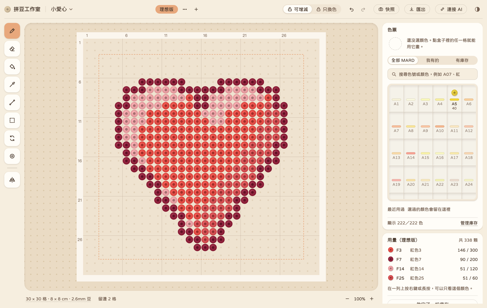

# 🫘 豆豆工作室 Bead Studio

AI 協作的拼豆設計工具。

## 啟動

需要 Node.js ≥ 24。

```bash
pnpm install
pnpm start          # http://localhost:5174
```

## 網頁介面



- 開發：`pnpm dev`（同時啟動伺服器與 Vite），開 http://localhost:5173。
- 正式使用：`pnpm build:web && pnpm start`，或用下面的 Docker，開 http://localhost:5174。
- 編輯區有畫筆、橡皮擦、油漆桶、吸管、直線、圓形、全域換色、掛孔等工具；右側是色票、用量與檢查結果。亮色與暗色模式可從右上角切換，豆子的顏色不會跟著變。
- AI 透過 MCP 改的設計會即時出現在網頁上（不用重新整理），被改到的豆子會跳一下。網頁上的每個修改也走同一套工具，AI 馬上讀得到。
- 右上角的「連接 AI」會顯示要貼進 Claude Code 的指令。
- 把圖片（含 bead-studio metadata 的 PNG 或一般圖片）拖進網頁就能匯入。
- 庫存頁（色票面板下方的「管理庫存」）可以勾選擁有的顏色、填顆數（也能秤重換算顆數），並校正各色的顯示色。用量面板的「做完了，扣庫存」會在你拼完作品後，依用量扣掉庫存。

## 用 Docker 執行

```bash
mkdir -p ~/BeadStudio        # 匯入／匯出圖片的交換資料夾
docker compose up -d --build # http://localhost:5174
docker compose logs -f       # 看 log
docker compose down          # 停止
```

- 埠只開在本機（`127.0.0.1:5174`）。
- `data/`、`config/` 掛進容器，作品與庫存都留在這個資料夾裡；AI 改了 `config/checks.json` 後執行 `docker compose restart` 生效。
- `~/BeadStudio` 以相同的絕對路徑掛進容器；`import_image`／`export_png` 只能使用這個資料夾裡的檔案。
- 更新程式碼後重新執行 `docker compose up -d --build`。
- 若把主機埠改成 5174 以外，記得在 `BEADS_ALLOWED_HOSTS` 加上 `localhost:新埠`。

## 連接 Claude Code

```bash
claude mcp add --transport http beads http://localhost:5174/mcp
```

在這個資料夾裡啟動 Claude Code，就會自動載入 `.claude/skills/bead-design` 設計知識。

## 環境變數

| 變數 | 預設 | 說明 |
|---|---|---|
| `PORT` | 5174 | 伺服器埠 |
| `BEADS_VISION` | auto | `off`：render_preview 改回傳文字描述（給不能看圖的模型） |
| `BEADS_DATA_DIR` | data | 設計、色表、庫存 |
| `BEADS_CONFIG_DIR` | config | 檢查器門檻 `checks.json` |
| `BEADS_HOST` | 127.0.0.1 | 監聽位址；Docker 映像內為 `0.0.0.0` |
| `BEADS_FILES_DIR` | （不限制） | 設定後 `import_image`／`export_png` 只能使用此資料夾（絕對路徑） |
| `BEADS_HOME_DIR` | 系統家目錄 | 展開 `~` 用的家目錄（絕對路徑）；Docker 內設為主機的家目錄 |
| `BEADS_ALLOWED_HOSTS` | （空） | 額外允許的 Host（`host:port`，逗號分隔）；預設只接受 `localhost:PORT` 與 `127.0.0.1:PORT`，其他 Host／Origin 一律 403 |

## 使用者資料

作品（`data/designs/`）、目前開啟狀態（`data/state.json`）與庫存（`data/inventory.json`）都存在 `data/` 底下，不會被 commit；只有色表 `data/palette.json` 納入版本控制。
